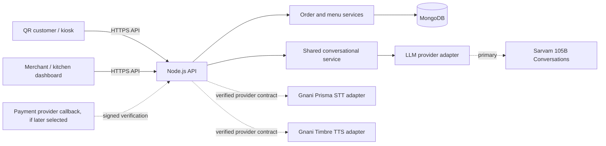

# Architecture

## 1. System overview

Two React customer clients (QR mobile web and kiosk mode) and a React merchant/kitchen dashboard use one Node.js API and shared order-processing rules. MongoDB stores outlet menu and order state. A single backend conversational layer serves both customer channels and calls a replaceable LLM adapter; Sarvam 105B Conversations is the planned primary provider. Gnani Prisma STT and Timbre TTS remain separate speech adapters. All provider calls and secrets stay server-side.



## 2. Pattern and stack

**Pattern:** Modular monolith for MVP; deployable as one API service with clear modules. This keeps operations and transactions understandable for a small team while preserving boundaries.

**Confirmed stack:** React, Node.js, MongoDB. Express is a likely choice but not yet confirmed. **Undecided:** TypeScript, framework/build tool, ORM/ODM, authentication, file/audio storage, hosting, observability, deployment, payment provider, and real-time transport. Inspect repository before choosing tools; do not add dependencies by default.

## 3. Components and responsibilities

- **Customer UI:** menu, draft cart, voice/touch input, quote display, explicit confirmation, payment instructions, token/status.
- **Merchant UI:** authenticated staff actions, menu availability, order queue, payment state, preparation status.
- **API boundary:** validation, session scoping, authorization, rate limiting, stable error responses.
- **Menu service:** source-of-truth availability, option validation, server pricing, immutable order snapshot.
- **Order service:** draft/confirmation, idempotency, token assignment, lifecycle transitions and audit events.
- **Conversational service:** shared by QR and kiosk; coordinates dialogue, recommendation policy, allowlisted tool requests, and provider-neutral results.
- **LLM adapter:** translate the internal conversation request/response contract to a provider API. Sarvam-specific model IDs, payloads, auth, streaming, usage, and errors stay inside its adapter; replacing the provider must not change business services or UI contracts.
- **Speech adapters:** normalize Gnani Prisma STT/Timbre TTS requests/results; fail safely; never make provider output authoritative for prices, payment, or final confirmation.
- **Recommendation policy:** answer customer-requested recommendations whenever asked. Allow at most one unsolicited recommendation per ordering session; never during review, confirmation, or payment; after a decline, do not proactively recommend again in that session.
- **Tool execution:** model proposals are limited to an explicit allowlist and revalidated by backend domain services. The LLM cannot create orders, confirm them, verify payment, or bypass quote and confirmation steps.

**As implemented - how a proposal reaches the draft.** The conversational
service and the cart service do not depend on each other: one produces
proposals and owns no ordering authority, the other owns every draft rule. The
wiring is `workflows/conversationTurn.ts`, an application-level workflow above
both, like `endOrderingSession.ts` and `confirmOrder.ts`. It reads the draft
through the cart service, hands the model a price-free summary of it, and
applies each validated draft action by calling the ordinary cart service
methods - the same path the HTTP cart routes take, so a spoken change and a tap
are validated identically. The workflow is injected with those two services and
nothing else, so there is no dependency through which model output could reach a
store, a quote, an order or payment state; that is the structural form of the
"the LLM cannot create orders" rule above, not just a prompt instruction. Its
one HTTP entry point is `POST /api/v1/conversation/turns`
([API.md](API.md)). A provider failure, or no provider configured at all,
leaves the cart endpoints untouched.

**As implemented - quoting the draft itself.** The same shape of gap existed
between the cart and quote services: `POST /api/v1/quotes` prices whatever
`items` array a caller sends, with nothing tying it to the session's actual
draft. `workflows/quoteFromCart.ts` closes it the same way - an
application-level function depending on the cart service and the quote
service and nothing else - by reading the draft and quoting exactly those
lines through the ordinary `quoteService.createQuote`, the same pricing and
validation path a hand-built quote request takes. Its one HTTP entry point is
`POST /api/v1/cart/quote` ([API.md](API.md)); it only reads the draft, never
writes it, and refuses outright - naming every bad line - while the draft
holds anything that cannot currently be ordered.
- **Persistence:** MongoDB repositories/indexes and controlled schema evolution.

## 4. Data and request flow

1. Client obtains an outlet-scoped ordering session using a QR/kiosk entry point.
2. Client fetches active menu and submits selected item IDs/options/quantities or a speech-derived intent, amending the server-side draft cart (the primary ordering interface) or, for a client holding its own draft, sending the selection straight to a quote.
3. API validates session scope and menu state, then returns the repriced draft and, at review, a server-calculated quote. A draft line whose item or option has gone away is returned with zero amounts and an issue code; the client must resolve it before checkout.
4. UI presents a review; customer explicitly confirms the quoted contents.
5. API validates current menu/prices again, applies idempotency, writes order and token, and returns the accepted order.
6. Payment remains pending/due until verified provider callback or authorized staff action.
7. If the LLM, STT/TTS provider, network, or available credits fail, preserve the draft and allow the customer to finish through touch using the same backend quote and order flow.
8. Dashboard fetches orders and submits authorized state transitions. Customer status reads are scoped to the order capability/session.

## 5. Dependency rules

- UI components call typed client/service functions, never MongoDB or provider SDKs directly.
- Routes handle transport concerns; business rules live in services.
- Menu and order services own authoritative validation and state transitions.
- Provider-specific payloads do not leak into domain models.
- Every customer request is scoped to its active outlet and session; merchant actions require server authorization.
- Shared schemas/contracts are reviewed by Ayush and Anvesh before both sides implement them.

## 6. Performance, resilience, failure

Keep menu payloads small and cache only public, versioned menu data briefly; always revalidate current availability and price at quote/confirmation. Paginate or bound dashboard order results. Do not lose draft state on transient speech/API errors. If MongoDB is unavailable, do not claim order creation; return a retryable error and preserve idempotency semantics. If speech provider is unavailable, offer touch ordering. If payment verification is delayed, retain pending status and show staff/customer that state. If dashboard refresh fails, show stale connection and last-update time. Real-time updates are optional; polling is acceptable for MVP until requirements and hosting are known.

## 7. Project structure guidance

Adapt to existing repository structure. A possible separation is `client/customer`, `client/merchant`, `server/routes`, `server/services`, `server/models`, `server/providers`, and shared contract/types. This is illustrative, not a mandate to restructure an existing repository.

**As implemented:** the repository already contained `backend/` and `frontend/`,
so those names were kept instead of `server/` and `client/`. npm workspaces:
`backend`, `frontend`, `shared`.

```
backend/src/{routes,services,models,providers,middleware,config,db}
backend/src/providers/llm       provider-neutral conversational contract
backend/src/providers/sarvam    Sarvam LLM adapter (see PROVIDERS.md)
backend/src/services/conversation  shared conversational service
backend/src/services/menu          menu authority, repository, lookup port impl
backend/src/services/quote         server-authoritative pricing
backend/src/services/cart          per-session draft cart
backend/src/services/sessions      anonymous ordering sessions
frontend/src/api              typed API client: the only place the client calls the API
frontend/src/customer         customer ordering flow (hook, surface, display rules)
frontend/src/audio            speech interfaces, declarations only (no provider call)
frontend/src/{components,pages,styles}
shared/src                      contracts depended on by both sides
```

Customer QR, customer kiosk and the merchant dashboard are currently three
surfaces within the single `frontend` app, switched by URL hash, rather than
separate builds. A routing library was not added because client tooling is still
an open decision. Splitting the merchant dashboard into its own build later
remains possible and is a contained change.

Provider adapter configuration is loaded by the adapter itself rather than added
to the core app config, so `config/env.ts` stays free of vendor fields and a
provider can be removed without touching shared configuration. The conversation
service loads its own budgets for the same reason.

The conversation service reaches menu data through a narrow read-only port
(`services/conversation/menuPort.ts`), implemented by
`services/menu/menuLookup.ts` over the same menu service that prices quotes, so
the model's search results and the customer's prices come from one authority.
The port has no write method, so no allowlisted tool can change menu state.

The draft cart (`services/cart`) is the **primary customer ordering interface**
(agreed; see [API.md](API.md)). Both QR and kiosk build the order against it,
because the shared conversational layer has to amend the same draft the touch UI
shows and a browser-only draft is invisible to a backend conversation tool. The
quote service is retained unchanged alongside it, for a client that holds its
own draft and for independent quote requests, so neither path is deprecated.

It stores selections only - item ID, option IDs and quantity - and reprices them
from the menu on every read, so a price can never go stale in storage. It shares
`services/quote/pricing.ts` with the quote service, which is the single place a
selection becomes a price; a draft total and a quote for the same selection
therefore cannot diverge. Identical selections merge into one draft line, while
a quote deliberately does not merge, because there the client owns the line list.

The draft is keyed by ordering session, mutations for one session are serialized,
and the integer `revision` gives clients optimistic concurrency, which is what
makes a voice turn and a touch tap safe to land at the same moment. A draft
remains a draft: order creation re-validates through a quote.

**As implemented:** drafts and ordering sessions are persisted in MongoDB, so a
restart or a second backend instance does not end a session or empty a draft
mid-order. Both are keyed by the SHA-256 hash of the session ID, so no bearer
token is stored; session and outlet scoping and both expiry deadlines are
enforced in the query filter, with TTL indexes for cleanup only. The revision
check is a conditional write, because the in-process lock cannot serialize two
instances - it now only keeps one process's own mutations from interleaving. A
mutation that carried no expected revision retries against the fresh draft; one
that carried a stale revision is still `409`. A draft's deadline is clamped to
`min(now + 30 minutes, session.expiresAt)` on every write, and ending a session
deletes its draft through `workflows/endOrderingSession.ts` - a workflow above
both services, so neither depends on the other. An unreachable store is a
retryable `503` and never a draft reported as saved. Details are in
[DATABASE.md](DATABASE.md) section 2; the response contract is unchanged.

Menu persistence sits behind `MenuRepository`: a MongoDB implementation in
production and an in-memory one for tests, which keeps pricing and validation
rules testable without a database. The database is resolved per request, so an
unreachable database becomes a retryable `503` rather than a crash.
Conversation state (recommendation policy, bounded reply history, and the last
menu item resolved for the session, which is what gives "two of those" a
referent) is in-memory and per session; persistence and retention remain open
decisions. Because it is keyed by session ID and bound to the session's outlet,
it is isolated like every other per-session resource, and it holds no money and
no model text - only items resolved from backend menu data.

**As implemented: customer frontend integration.** The client is layered so that
only `frontend/src/api/client.ts` performs a request: it holds the ordering
session bearer (module state mirrored into per-tab `sessionStorage`, never a URL
or a log), sends `If-Match` for a draft change aimed at a line the customer has
seen, sends the per-attempt `Idempotency-Key` on confirmation, and uses the
order's own read capability - not the session - for tracking, which is what
keeps tracking alive after the 30-minute session expires. `customer/useOrdering.ts`
holds the flow (session, menu, draft, quote, confirmation, tracking poll) and
translates `401` into "session ended, restart" and `409` into a re-read of the
draft rather than an overwrite of the other surface's edit. `customer/cartRules.ts`
is the only display logic: it formats server amounts and decides why checkout is
blocked. No component computes a price, a total or an availability flag, and the
only call that creates an order is made from an explicit "Confirm order" press.

The conversational path is one more call to the same backend route, so typed
text and a future transcript travel identically. Speech itself is interfaces
only (`frontend/src/audio/types.ts`): capture in the browser, STT and TTS behind
backend routes that do not exist yet, so no provider credential or unverified
Gnani wire shape reaches the client. With no speech client supplied - the state
this milestone ships in - the surface is touch-and-type, and a `503` from the
assistant switches it to touch-only with the draft intact.

## 8. Key decisions and unresolved items

Confirmed: React + Node.js + MongoDB, shared backend, two ordering channels, stated languages, Gnani Prisma/Timbre speech providers, payment choices, tokens, merchant dashboard, ownership split. Planned provider decision: Sarvam 105B Conversations for the primary conversational LLM; dashboard access and credits are not yet confirmed. Assumed: modular monolith, one outlet for MVP, provider adapters, INR. Resolve framework, authentication/session mechanism, payment verification integration, hosting, logging/monitoring, realtime approach, backup and retention before deployment. See [PRD.md](PRD.md), [API.md](API.md), and [PROVIDERS.md](PROVIDERS.md).
