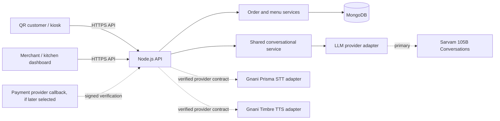

# Architecture

## 1. System overview

Two React customer clients (QR mobile web and kiosk mode) and a React merchant/kitchen dashboard use one Node.js API and shared order-processing rules. MongoDB stores outlet menu and order state. A single backend conversational layer serves both customer channels and calls a replaceable LLM adapter; Sarvam 105B Conversations is the planned primary provider. Gnani Prisma STT and Timbre TTS remain separate speech adapters. All provider calls and secrets stay server-side.



## 2. Pattern and stack

**Pattern:** Modular monolith for MVP; deployable as one API service with clear modules. This keeps operations and transactions understandable for a small team while preserving boundaries.

**Confirmed stack:** React, Node.js, MongoDB. Express is a likely choice but not yet confirmed. **Undecided:** TypeScript, framework/build tool, ORM/ODM, authentication, file/audio storage, hosting, observability, deployment, payment provider, and real-time transport. Inspect repository before choosing tools; do not add dependencies by default.

## 3. Components and responsibilities

- **Customer UI:** menu, draft cart, voice/touch input, quote display, explicit confirmation, payment instructions, token/status.
- **Merchant UI:** authenticated staff actions, menu availability, order queue, payment state, preparation status.
- **API boundary:** validation, session scoping, authorization, rate limiting, stable error responses.
- **Menu service:** source-of-truth availability, option validation, server pricing, immutable order snapshot.
- **Order service:** draft/confirmation, idempotency, token assignment, lifecycle transitions and audit events.
- **Conversational service:** shared by QR and kiosk; coordinates dialogue, recommendation policy, allowlisted tool requests, and provider-neutral results.
- **LLM adapter:** translate the internal conversation request/response contract to a provider API. Sarvam-specific model IDs, payloads, auth, streaming, usage, and errors stay inside its adapter; replacing the provider must not change business services or UI contracts.
- **Speech adapters:** normalize Gnani Prisma STT/Timbre TTS requests/results; fail safely; never make provider output authoritative for prices, payment, or final confirmation.
- **Recommendation policy:** answer customer-requested recommendations whenever asked. Allow at most one unsolicited recommendation per ordering session; never during review, confirmation, or payment; after a decline, do not proactively recommend again in that session.
- **Tool execution:** model proposals are limited to an explicit allowlist and revalidated by backend domain services. The LLM cannot create orders, confirm them, verify payment, or bypass quote and confirmation steps.
- **Persistence:** MongoDB repositories/indexes and controlled schema evolution.

## 4. Data and request flow

1. Client obtains an outlet-scoped ordering session using a QR/kiosk entry point.
2. Client fetches active menu and submits selected item IDs/options/quantities or a speech-derived intent.
3. API validates session scope and menu state, then returns a server-calculated quote.
4. UI presents a review; customer explicitly confirms the quoted contents.
5. API validates current menu/prices again, applies idempotency, writes order and token, and returns the accepted order.
6. Payment remains pending/due until verified provider callback or authorized staff action.
7. If the LLM, STT/TTS provider, network, or available credits fail, preserve the draft and allow the customer to finish through touch using the same backend quote and order flow.
8. Dashboard fetches orders and submits authorized state transitions. Customer status reads are scoped to the order capability/session.

## 5. Dependency rules

- UI components call typed client/service functions, never MongoDB or provider SDKs directly.
- Routes handle transport concerns; business rules live in services.
- Menu and order services own authoritative validation and state transitions.
- Provider-specific payloads do not leak into domain models.
- Every customer request is scoped to its active outlet and session; merchant actions require server authorization.
- Shared schemas/contracts are reviewed by Ayush and Anvesh before both sides implement them.

## 6. Performance, resilience, failure

Keep menu payloads small and cache only public, versioned menu data briefly; always revalidate current availability and price at quote/confirmation. Paginate or bound dashboard order results. Do not lose draft state on transient speech/API errors. If MongoDB is unavailable, do not claim order creation; return a retryable error and preserve idempotency semantics. If speech provider is unavailable, offer touch ordering. If payment verification is delayed, retain pending status and show staff/customer that state. If dashboard refresh fails, show stale connection and last-update time. Real-time updates are optional; polling is acceptable for MVP until requirements and hosting are known.

## 7. Project structure guidance

Adapt to existing repository structure. A possible separation is `client/customer`, `client/merchant`, `server/routes`, `server/services`, `server/models`, `server/providers`, and shared contract/types. This is illustrative, not a mandate to restructure an existing repository.

**As implemented:** the repository already contained `backend/` and `frontend/`,
so those names were kept instead of `server/` and `client/`. npm workspaces:
`backend`, `frontend`, `shared`.

```
backend/src/{routes,services,models,providers,middleware,config,db}
backend/src/providers/llm       provider-neutral conversational contract
backend/src/providers/sarvam    Sarvam LLM adapter (see PROVIDERS.md)
backend/src/services/conversation  shared conversational service
backend/src/services/menu          menu authority, repository, lookup port impl
backend/src/services/quote         server-authoritative pricing
backend/src/services/sessions      anonymous ordering sessions
frontend/src/{api,components,pages,styles}
shared/src                      contracts depended on by both sides
```

Customer QR, customer kiosk and the merchant dashboard are currently three
surfaces within the single `frontend` app, switched by URL hash, rather than
separate builds. A routing library was not added because client tooling is still
an open decision. Splitting the merchant dashboard into its own build later
remains possible and is a contained change.

Provider adapter configuration is loaded by the adapter itself rather than added
to the core app config, so `config/env.ts` stays free of vendor fields and a
provider can be removed without touching shared configuration. The conversation
service loads its own budgets for the same reason.

The conversation service reaches menu data through a narrow read-only port
(`services/conversation/menuPort.ts`), implemented by
`services/menu/menuLookup.ts` over the same menu service that prices quotes, so
the model's search results and the customer's prices come from one authority.
The port has no write method, so no allowlisted tool can change menu state.

Menu persistence sits behind `MenuRepository`: a MongoDB implementation in
production and an in-memory one for tests, which keeps pricing and validation
rules testable without a database. The database is resolved per request, so an
unreachable database becomes a retryable `503` rather than a crash.
Conversation state (recommendation policy, bounded reply history) is in-memory
and per session; persistence and retention remain open decisions.

## 8. Key decisions and unresolved items

Confirmed: React + Node.js + MongoDB, shared backend, two ordering channels, stated languages, Gnani Prisma/Timbre speech providers, payment choices, tokens, merchant dashboard, ownership split. Planned provider decision: Sarvam 105B Conversations for the primary conversational LLM; dashboard access and credits are not yet confirmed. Assumed: modular monolith, one outlet for MVP, provider adapters, INR. Resolve framework, authentication/session mechanism, payment verification integration, hosting, logging/monitoring, realtime approach, backup and retention before deployment. See [PRD.md](PRD.md), [API.md](API.md), and [PROVIDERS.md](PROVIDERS.md).
